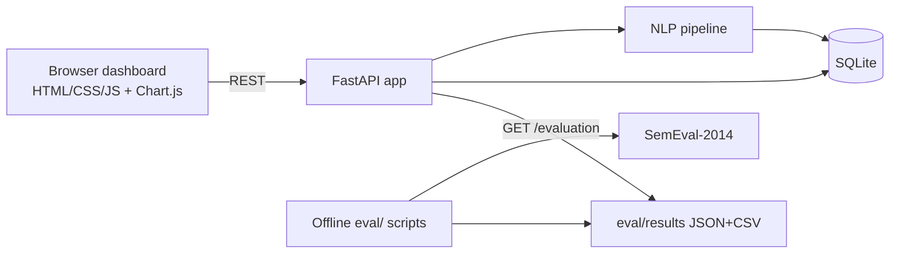

# ARCHITECTURE.md — Tech + Module Breakdown

## 1. System diagram


## 2. Stack
Python 3.11 · FastAPI · Uvicorn · Pydantic · SQLite · spaCy `en_core_web_sm` · NLTK · VADER · sentence-transformers (MiniLM) · HF Transformers · Chart.js · pytest · Docker (HF Spaces).

## 3. Repository layout
```
aspectlens/
├── app/
│   ├── main.py          # FastAPI app, lifespan (load models once), routes, static mount
│   ├── schemas.py       # Pydantic request/response models
│   ├── db.py            # SQLite setup + queries
│   ├── config.py        # settings (limits, min_freq, scorer default, paths)
│   └── limits.py        # rate limiting + size caps
├── nlp/
│   ├── preprocess.py    # clean, strip PII, contractions, sentence split, offsets
│   ├── aspects.py       # candidates: RegexpParser | spaCy chunks | dependency rules; filter
│   ├── grouping.py      # WordNet + embeddings + seed lexicon → canonical aspects
│   ├── opinions.py      # opinion linking, clause split, negation
│   ├── sentiment.py     # Scorer interface: vader | transformer | finetuned
│   ├── pipeline.py      # review text → structured aspect results
│   └── aggregate.py     # per-product/aspect stats, trends, snippets
├── data/
│   ├── demo_sample.*    # precomputed, < 20 MB, committed
│   ├── seed_lexicon.json
│   └── scripts/         # download_semeval.py, download_amazon.py, build_demo_sample.py
├── eval/
│   ├── run_all.py       # ONE command regenerates everything
│   ├── extraction_eval.py  ablation.py  sentiment_eval.py
│   ├── baseline_tfidf.py   amazon_value.py  latency.py  error_analysis.py
│   └── results/         # JSON + CSV read by /evaluation and README
├── frontend/            # index.html, app.js, style.css
├── tests/
├── notebooks/finetune_absa.ipynb   # optional Colab
├── docs/presentation_outline.md
├── Dockerfile  .dockerignore  requirements.txt  README.md  .gitignore
└── BRAIN.md PLAN.md ARCHITECTURE.md DESIGN_SYSTEM.md SECURITY_AND_ACCESS.md DATABASE_SCHEMA.md
```

## 4. Pipeline (one review)
| Step | Module | Syllabus | Notes |
|---|---|---|---|
| 1 Preprocess | `preprocess.py` | U2, U3 | strip HTML/whitespace, regex PII removal, expand contractions, sentence split, tokenize; keep original + lowercase copy; **offsets map to original** |
| 2 POS tag | spaCy | U4 | full sentence, no stopword removal |
| 3 Candidates | `aspects.py` | U4 | RegexpParser `NP: {<DT>?<JJ>*<NN.*>+}`, spaCy noun chunks, dependency rules (nsubj+acomp, amod+noun) |
| 4 Filter | `aspects.py` | U2 | lemmatize, generic-noun blacklist, per-product min frequency (default 5) |
| 5 Group | `grouping.py` | U2, U5 | WordNet synonyms/hypernyms + cosine sim + agglomerative clustering + seed lexicon |
| 6 Opinions | `opinions.py` | U4 | dependency first → ≤5-token same-clause window; split at contrast words; negation/intensifiers |
| 7 Sentiment | `sentiment.py` | U7 | VADER / transformer on aspect clause / fine-tuned (sentence+aspect) |
| 8 Aggregate | `aggregate.py` | — | counts, pos/neg %, avg score, monthly trend, top snippets |

Each extractor and scorer is chosen via config / request parameter so ablations are one flag away.

## 5. Core contracts
**Scorer interface**
```python
class Scorer(Protocol):
    name: str

    def score(self, clause: str, aspect: str, opinion_words: list[str]) -> ScoreResult: ...


# ScoreResult: label ("positive"|"negative"|"neutral"), confidence (0-1), opinion_words
```
**Pipeline output** (`POST /analyze` response)
```json
{
  "text": "Battery life is amazing, but the delivery was late and the price is too high.",
  "scorer": "vader",
  "aspects": [
    {"term": "Battery life", "canonical": "Battery", "start": 0, "end": 12,
     "sentiment": "positive", "confidence": 0.91, "opinion_words": ["amazing"]},
    {"term": "delivery", "canonical": "Delivery", "start": 35, "end": 43,
     "sentiment": "negative", "confidence": 0.78, "opinion_words": ["late"]}
  ],
  "latency_ms": 42
}
```
`start`/`end` are character offsets in the **original** text so the frontend can highlight.

## 6. API
| Method + path | Purpose |
|---|---|
| `GET /health` | status + models loaded |
| `POST /analyze` | one review → aspects (`scorer`, `extractor` optional) |
| `POST /analyze/batch` | list of reviews (capped) |
| `POST /upload` | CSV + column mapping (size/row capped) |
| `GET /products` | list products |
| `GET /products/{id}/summary` | per-aspect stats, trend, snippets |
| `GET /compare?a=&b=` | side-by-side aspect stats |
| `GET /evaluation` | stored benchmark results |
| `GET /docs` | FastAPI auto docs |

**Error shape (always):** `{"error": {"code": "TEXT_TOO_LONG", "message": "…"}}` — never a stack trace.

## 7. Runtime behaviour
- **Lifespan startup:** load spaCy, NLTK data, MiniLM, VADER, transformer once → store on `app.state`.
- **Cold start:** HF free Spaces sleep when idle; first request may be slow. Document in README.
- **Memory fallback:** if roberta won't fit free-tier RAM, switch default to the DistilBERT SST-2 model (binary → neutral via low-confidence threshold) and tell the human.
- **Demo data:** app ships with a precomputed sample loaded into SQLite on first start, so no downloads at runtime.

## 8. Offline evaluation
`python -m eval.run_all` → runs all scripts with fixed seeds + identical splits → writes `eval/results/*.json|csv` → `/evaluation` and README read only these files.

## 9. Testing strategy
Unit (preprocess, extraction, grouping, opinions, scorers w/ mocked heavy models) · API (TestClient) · golden test: the example review must produce battery+, delivery−, price−.

## 10. Extension points
New scorer = implement `Scorer` + register · new domain = add seed lexicon JSON · new extractor = add function + flag.
