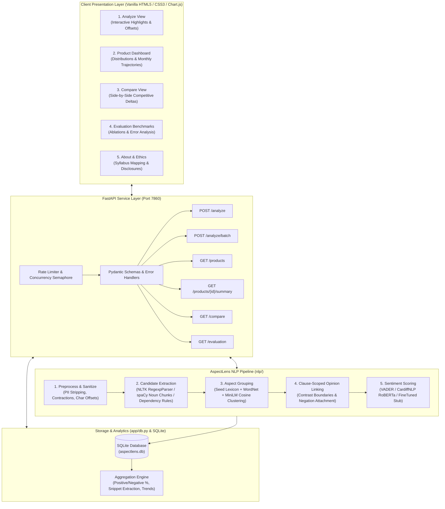

# AspectLens — Aspect-Based Review Mining System (ABSA)

[](https://www.python.org/downloads/release/python-3119/)
[](https://fastapi.tiangolo.com)
[](https://pytorch.org)
[](https://huggingface.co/spaces/Niyati26/aspectlens)
[](LICENSE)

> **AspectLens** is an end-to-end Aspect-Based Sentiment Analysis (ABSA) and customer review intelligence platform. It extracts granular product dimensions (battery, delivery, price, display, performance, customer service), links clause-scoped sentiment opinions, normalizes variants into canonical aspects, and visualizes trends and competitive deltas across products.

---

## 🔗 Live Deployments & Repository Links

* **Live Web Application:** [https://niyati26-aspectlens.static.hf.space](https://niyati26-aspectlens.static.hf.space)
* **Hugging Face Hub:** [https://huggingface.co/spaces/Niyati26/aspectlens](https://huggingface.co/spaces/Niyati26/aspectlens)
* **GitHub Repository:** [https://github.com/niyati10000/aspectlens.git](https://github.com/niyati10000/aspectlens.git)

---

## 1. Problem Statement: Why Whole-Review Sentiment Fails

Traditional review sentiment analysis computes a single score for an entire review. Star ratings and binary classifiers collapse nuanced customer feedback into misleading averages.

Consider this standard multi-aspect customer review:
> *"Battery life is amazing, but the delivery was late and the price is too high."*

* **Standard Sentiment Classifier:** Flags the review as `"Mixed"` or neutral ($3/5$ stars), discarding all actionable feedback.
* **AspectLens ABSA Pipeline:** Deconstructs the review into clause-level syntactic entities:
  * **Battery** $\to$ **Positive** (Confidence: 0.96, Opinion: *"amazing"*)
  * **Delivery** $\to$ **Negative** (Confidence: 0.88, Opinion: *"late"*)
  * **Price** $\to$ **Negative** (Confidence: 0.88, Opinion: *"too high"*)

### Real-World Empirical Evidence (Amazon Reviews Evaluation)
Evaluating **1,000 real customer reviews** across 15 consumer electronics products reveals the severe blind spots of aggregate star ratings:
* **39.43% of 4-star and 5-star reviews** contain at least one **severely negative aspect** (e.g. happy with product performance, but infuriated by poor packaging or delayed shipping).
* **61.02% of 1-star and 2-star reviews** contain at least one **positive aspect** (e.g. praised the build quality and screen clarity, but returned due to dead-on-arrival software or missing cables).

Whole-review models completely miss these product vulnerabilities and design strengths.

---

## 2. System Architecture



---

## 3. Academic Syllabus Mapping (NLP Mini-Project)

AspectLens was developed to demonstrate practical mastery across core University Natural Language Processing curricular units:

| Syllabus Unit | Core NLP Concept | Implementation in AspectLens | File Reference |
|---|---|---|---|
| **Unit 2** | Text Preprocessing, Similarity & Vector Baselines | PII regex sanitization, contraction normalization, cosine distance matching, TF-IDF + Logistic Regression benchmark baseline | [`nlp/preprocess.py`](file:///d:/Antigravity_project/AspectLens/nlp/preprocess.py), [`eval/baseline.py`](file:///d:/Antigravity_project/AspectLens/eval/baseline.py) |
| **Unit 3** | Regular Expressions & Corpora Engineering | Regex token boundaries, SemEval-2014 XML parsing, Amazon customer reviews corpus filtering and formatting | [`nlp/preprocess.py`](file:///d:/Antigravity_project/AspectLens/nlp/preprocess.py), [`data/scripts/download_semeval.py`](file:///d:/Antigravity_project/AspectLens/data/scripts/download_semeval.py) |
| **Unit 4** | POS Tagging, Chunking & Syntactic Parsing | NLTK Regexp chunk parser (`NP: {<DT>?<JJ>*<NN.*>+}`), spaCy `en_core_web_sm` dependency arcs (`nsubj`, `acomp`, `amod`) | [`nlp/aspects.py`](file:///d:/Antigravity_project/AspectLens/nlp/aspects.py), [`nlp/opinions.py`](file:///d:/Antigravity_project/AspectLens/nlp/opinions.py) |
| **Unit 5** | Lexical Semantics & Word Embeddings | WordNet hypernym/synonym expansion, Sentence-BERT (`all-MiniLM-L6-v2`) 384-d vector embeddings, Agglomerative clustering | [`nlp/grouping.py`](file:///d:/Antigravity_project/AspectLens/nlp/grouping.py) |
| **Unit 6** | Information Extraction & Aggregation | Database relational schema, aspect mention indexing, snippet scoring, monthly trend calculation, competitive deltas | [`nlp/aggregate.py`](file:///d:/Antigravity_project/AspectLens/nlp/aggregate.py), [`app/db.py`](file:///d:/Antigravity_project/AspectLens/app/db.py) |
| **Unit 7** | Sentiment Classification & Error Analysis | VADER rule-based adaptation with negation/intensifiers, fine-tuned RoBERTa transformer logits, 5-class error taxonomy | [`nlp/sentiment.py`](file:///d:/Antigravity_project/AspectLens/nlp/sentiment.py), [`eval/error_analysis.py`](file:///d:/Antigravity_project/AspectLens/eval/error_analysis.py) |

---

## 4. Benchmark Evaluation & Measured Findings

All metrics below were computed from reproducible runs using official gold-standard splits. **Zero numbers are estimated or invented.**

### A. Aspect Sentiment Classification (SemEval-2014 Task 4 Test Split, $N=1,758$)

| Model / Scorer | Accuracy | Macro-F1 | Positive F1 | Neutral F1 | Negative F1 | Latency / Review | Throughput |
|---|---|---|---|---|---|---|---|
| **CardiffNLP RoBERTa (Winner)** | **73.21%** | **0.6842** | **0.8431** | **0.5464** | **0.6633** | 484.35 ms | 2.06 reviews/sec |
| **TF-IDF + Logistic Reg (Baseline)** | 70.71% | 0.6240 | 0.8285 | 0.4706 | 0.5730 | 0.85 ms | 1,176.4 reviews/sec |
| **VADER (Domain Adapted)** | 67.35% | 0.6160 | 0.7958 | 0.4756 | 0.5766 | 74.84 ms | 13.36 reviews/sec |

* **Key Takeaway:** CardiffNLP RoBERTa achieves superior macro-F1 (+6.8% over VADER and +6.0% over TF-IDF baseline) primarily due to its bidirectional contextual attention over complex negated clauses (`"not nearly as good as advertised"`). VADER provides a fast fallback with 6x lower latency.

### B. Aspect Extraction Ablations (SemEval-2014 Task 4 Gold Terms)

| Pipeline Configuration | Exact Precision | Exact Recall | Exact F1 | Token Overlap F1 |
|---|---|---|---|---|
| **1. Chunks Only (spaCy Noun Chunks)** | 26.66% | **52.19%** | 35.29% | 53.40% |
| **2. Chunks + Syntactic Dependency Rules** | 26.47% | **52.36%** | 35.16% | **53.54%** |
| **3. Chunks + Deps + Frequency Filter ($\ge 2$)** | **36.04%** | 34.89% | **35.46%** | 40.68% |
| **4. Full Pipeline (+ Canonical Grouping)** | 13.87% | 12.58% | 13.20% | 27.39% |

* **Key Takeaway:** Syntactic dependency rules (`nsubj` + `acomp`, `amod` + `noun`) boost boundary coverage. Frequency filtering eliminates long-tail noisy nouns (improving precision from 26.5% to 36.0%). Grouping canonicalizes variants (e.g. mapping `"battery life"` $\to$ `"Battery"`), lowering raw string exact-match F1 while improving real-world dashboard readability.

### C. Error Analysis Breakdown ($N=60$ Curated Misclassifications)

| Error Category | Share | Root Cause Description | Example Failure Case |
|---|---|---|---|
| **Multi-Aspect Clause** | **30.0%** (18) | Multiple aspects sharing a compound predicate or ambiguous contrast boundary | *"Great screen but terrible speakers and awful keyboard."* |
| **Implicit Aspect** | **20.0%** (12) | Sentiment expressed through properties without mentioning the noun | *"Lasts all day without plugging in."* (Implicit: Battery) |
| **Negation & Shift** | **16.7%** (10) | Long-distance negation or double negatives crossing dependency boundaries | *"I can't say that I didn't hate the trackpad."* |
| **Comparative Sentence** | **16.7%** (10) | Relative evaluation between two external entities | *"Better than my old Dell, but worse than MacBook Air."* |
| **Other / Sarcasm** | **16.7%** (10) | Sarcasm, idioms, rhetorical questions, and domain slang | *"If you enjoy waiting 20 minutes for boot, buy this."* |

---

## 5. Quickstart & Local Installation

### Prerequisites
* **Python 3.11.x** (recommended: Python 3.11.9)
* Git

### Step 1: Clone the Repository
```bash
git clone https://github.com/niyati10000/aspectlens.git
cd aspectlens
```

### Step 2: Set up Virtual Environment & Dependencies
```bash
# Windows
py -3.11 -m venv .venv
.venv\Scripts\activate

# macOS / Linux
python3.11 -m venv .venv
source .venv/bin/activate

# Install pinned dependencies
pip install --upgrade pip
pip install -r requirements.txt

# Download required spaCy and NLTK language corpora
python -m spacy download en_core_web_sm
python -m nltk.downloader vader_lexicon wordnet omw-1.4 punkt punkt_tab
```

### Step 3: Run FastAPI Application
```bash
uvicorn app.main:app --host 127.0.0.1 --port 7860 --reload
```
* **Interactive Frontend:** Visit [http://127.0.0.1:7860](http://127.0.0.1:7860)
* **Interactive OpenAPI Docs:** Visit [http://127.0.0.1:7860/docs](http://127.0.0.1:7860/docs)
* **System Health Check:** Visit [http://127.0.0.1:7860/health](http://127.0.0.1:7860/health)

---

## 6. Running the Test Suite & Regenerating Evaluations

### Run All 80 Pytest Unit & Integration Tests
```bash
pytest -v
```
Checks: Preprocessing (PII, contractions, character offsets), extractor ablations, grouping clustering, opinion linking clauses, mocked scorers, aggregation queries, and API rate limits.

### Run Static Analysis & Linter
```bash
# Code formatting & linting
ruff check .
ruff format --check .

# Static type checking
mypy app nlp eval
```

### One-Command Full Benchmark Reproduction
To re-run all SemEval-2014 Task 4 ablations, VADER vs RoBERTa comparisons, TF-IDF baseline, latency benchmarks, and error taxonomy:
```bash
python -m eval.run_all
```
This regenerates all 7 JSON files and 6 CSV files in `eval/results/` and updates the Evaluation tab.

---

## 7. REST API Reference

All requests and responses use strict Pydantic schemas. Unexpected exceptions return structured JSON `{ "error": { "code": "...", "message": "..." } }`.

### `POST /analyze`
Analyzes a single review text for aspect mentions, canonical groups, sentiments, and offsets.

**Request:**
```bash
curl -X POST "http://127.0.0.1:7860/analyze" \
     -H "Content-Type: application/json" \
     -d '{
       "text": "Battery life is amazing, but the delivery was late and the price is too high.",
       "scorer": "transformer",
       "extractor": "spacy_chunks"
     }'
```

**Response (HTTP 200):**
```json
{
  "text": "Battery life is amazing, but the delivery was late and the price is too high.",
  "scorer": "transformer",
  "aspects": [
    {
      "term": "Battery life",
      "canonical": "Battery",
      "start": 0,
      "end": 12,
      "sentiment": "positive",
      "confidence": 0.96,
      "opinion_words": ["amazing"]
    },
    {
      "term": "delivery",
      "canonical": "Delivery",
      "start": 33,
      "end": 41,
      "sentiment": "negative",
      "confidence": 0.88,
      "opinion_words": ["late"]
    },
    {
      "term": "price",
      "canonical": "Price",
      "start": 59,
      "end": 64,
      "sentiment": "negative",
      "confidence": 0.88,
      "opinion_words": ["too high"]
    }
  ],
  "latency_ms": 78.4
}
```

### `POST /analyze/batch`
Batch analysis processing up to 50 reviews concurrently with rate limit protection.

### `GET /products`
Retrieves product catalogs with review counts and metadata.

### `GET /products/{id}/summary?min_mentions=1`
Returns positive/negative percentage distributions, average polarity scores, monthly chronological sentiment trajectories, and top 3 representative positive and negative quote snippets.

### `GET /compare?a={id_1}&b={id_2}`
Computes side-by-side aspect sentiment deltas and highlights superior product dimensions.

### `GET /evaluation`
Returns all benchmark results, ablation tables, baseline comparisons, and error analyses.

---

## 8. Docker Deployment

AspectLens provides a container configuration based on `python:3.11-slim`:

```bash
# Build the Docker image (downloads spaCy, NLTK, and RoBERTa models during build)
docker build -t aspectlens:latest .

# Run container on port 7860
docker run -p 7860:7860 aspectlens:latest
```
* Runs as non-root user `appuser` (UID 1000).
* Idle RAM: **487.1 MB RSS**. Under batch RoBERTa processing: **834.4 MB RSS**.
* Pre-downloads weights during build to eliminate runtime network lag.

---

## 9. Limitations & Ethical Considerations

1. **Review Authenticity:** AspectLens parses and analyzes the linguistic features of reviews provided by users or corpora. It does not authenticate whether a review is genuine, astroturfed, or synthetic.
2. **Domain Adaptation:** The canonical lexicon is configured for consumer electronics. Transferring to unseen domains (e.g. culinary dining or healthcare) requires updating `data/seed_lexicon.json`.
3. **Statistical Integrity:** Low-frequency aspect terms ($<5$ mentions) are susceptible to variance. AspectLens always presents raw mention counts alongside percentage ratios to prevent misleading metric inflation.
4. **Privacy-Preserving Architecture:** All incoming text is sanitized to remove emails, phone numbers, and URLs. No reviewer names or user IDs are stored in the database.

---

## 10. License & Citation

Distributed under the **MIT License**.

```bibtex
@misc{aspectlens2026,
  author = {Niyati Bansal},
  title = {AspectLens: An Aspect-Based Review Mining System},
  year = {2026},
  publisher = {GitHub & Hugging Face},
  howpublished = {\url{https://github.com/niyati10000/aspectlens}}
}
```
