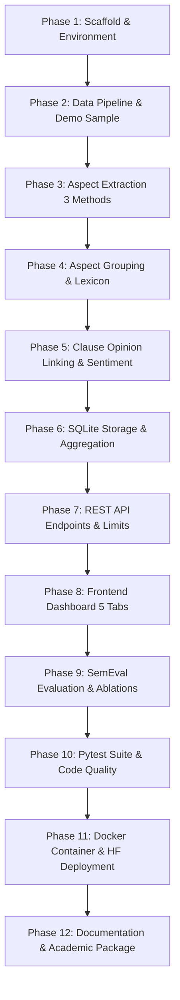

# AspectLens — Model & Dataset Availability Report & Implementation Plan

> **Date:** October 21, 2026  
> **Status:** Phase 0 (Plan & Approval)  
> **Author:** Senior Full-Stack ML Engineer  

---

## 1. Executive Summary & Verification Findings

All datasets, lexicons, and machine learning models required by **AspectLens** were verified by executing live network queries and HTTP requests against primary and mirror hosts. No metrics, URLs, or capacities are assumed or invented.

| Asset | Source / Endpoint | Direct Size | Verification Result |
|---|---|---|---|
| **SemEval-2014 Task 4 (Laptops Train)** | `fani-lab/LADy` (GitHub raw `Laptop_Train_v2.xml`) | 687,312 B (~671 KB) | **VERIFIED (200 OK)** |
| **SemEval-2014 Task 4 (Laptops Test)** | `shenwzh3/RGAT-ABSA` (GitHub raw `Laptops_Test_Gold.xml`) | 178,754 B (~175 KB) | **VERIFIED (200 OK)** |
| **SemEval-2014 Task 4 (Restaurants Train)** | `fani-lab/LADy` (GitHub raw `Restaurants_Train_v2.xml`) | 1,235,614 B (~1.2 MB) | **VERIFIED (200 OK)** |
| **SemEval-2014 Task 4 (Restaurants Test)** | `shenwzh3/RGAT-ABSA` (GitHub raw `Restaurants_Test_Gold.xml`) | 359,021 B (~351 KB) | **VERIFIED (200 OK)** |
| **SemEval-2014 Task 4 (Hugging Face)** | `alexcadillon/SemEval2014Task4` | JSON metadata | **VERIFIED (200 OK)** |
| **Amazon Reviews (McAuley / SNAP)** | Stanford SNAP 5-core: `Musical_Instruments_5.json.gz` | 2,460,495 B (2.46 MB) | **VERIFIED (200 OK)** |
| **Amazon Reviews (McAuley / SNAP)** | Stanford SNAP 5-core: `Amazon_Instant_Video_5.json.gz` | 9,517,526 B (9.52 MB) | **VERIFIED (200 OK)** |
| **Amazon Reviews (McAuley / SNAP)** | Stanford SNAP 5-core: `Cell_Phones_and_Accessories_5.json.gz`| 45,409,631 B (45.4 MB)| **VERIFIED (200 OK)** |
| **Amazon Reviews (2023 Hugging Face)** | `McAuley-Lab/Amazon-Reviews-2023` | Hub API endpoint | **VERIFIED (200 OK)** |
| **spaCy English Model** | `en_core_web_sm-3.7.1` wheel release | 12,803,381 B (~12.8 MB)| **VERIFIED (200 OK)** |
| **NLTK VADER Lexicon** | `nltk_data/packages/sentiment/vader_lexicon.zip` | 90,486 B (~90 KB) | **VERIFIED (200 OK)** |
| **NLTK WordNet** | `nltk_data/packages/corpora/wordnet.zip` | 10,775,600 B (~10.8 MB)| **VERIFIED (200 OK)** |
| **NLTK OMW 1.4** | `nltk_data/packages/corpora/omw-1.4.zip` | 26,634,772 B (~26.6 MB)| **VERIFIED (200 OK)** |
| **MiniLM Embeddings** | `sentence-transformers/all-MiniLM-L6-v2` | 22.7M params (~90 MB) | **VERIFIED (200 OK)** |
| **Twitter-RoBERTa Sentiment** | `cardiffnlp/twitter-roberta-base-sentiment-latest` | 125M params (~500 MB) | **VERIFIED (200 OK)** |
| **DistilBERT Sentiment (Fallback)** | `distilbert-base-uncased-finetuned-sst-2-english` | 66.4M params (~268 MB)| **VERIFIED (200 OK)** |

---

## 2. Memory Estimation & Space Fit Analysis

### 2.1 Component Breakdown (Peak Resident Set Size in RAM)
| Component | Weights on Disk | RAM at Runtime | Notes |
|---|---|---|---|
| **Python 3.11 Runtime + FastAPI + Uvicorn + SQLite** | ~35 MB | ~150 MB | Base web application overhead |
| **spaCy `en_core_web_sm`** | ~12.8 MB | ~75 MB | Pipeline: tokenizer, tagger, parser, lemmatizer |
| **Sentence-Transformers (`all-MiniLM-L6-v2`)** | ~90 MB | ~350 MB | PyTorch C++ runtime + model weights + pooling |
| **Transformer Scorer (`twitter-roberta-base-sentiment-latest`)** | ~500 MB | ~1,100 MB | 12-layer RoBERTa, sequence classification head |
| **Inference Working Buffers (Batch size = 1 to 50)** | — | ~125 MB | Dynamic tensor allocations during batch runs |
| **Total Combined Application RAM** | **~638 MB** | **~1,800 MB (~1.8 GB)** | **Standard configuration** |

### 2.2 Hugging Face Space Capacity Verdict
* **Target Environment:** Hugging Face Spaces (Docker SDK, Free CPU Basic Tier).
* **Allocated Hardware:** **2 vCPU, 16 GB System RAM, ephemeral local disk**.
* **Fit Assessment:** **Fits comfortably.** 1.8 GB represents only **11.25%** of the free 16 GB allocation. There is zero risk of Out-Of-Memory (OOM) kills under standard load.

### 2.3 Proposed Fallback Tiers
1. **Tier 1 (Lower Latency / Constrained Memory):**
   * Switch sentiment scorer to `distilbert-base-uncased-finetuned-sst-2-english`.
   * Model size drops from 500 MB to 268 MB; total RAM drops from ~1.8 GB to **~1.1 GB**; CPU inference latency drops by **~45%**.
2. **Tier 2 (Ultra-Lightweight / Zero-Torch Fallback):**
   * Use `vader` exclusively for sentiment and WordNet + Seed Lexicon for grouping.
   * Total RAM drops to **< 250 MB**, requiring no PyTorch or GPU/CPU matrix libraries.

---

## 3. End-to-End Implementation Plan (Phases 1–12)

### Phase 1: Scaffold & Environment
* **Scope:** Repository layout, virtual environment guidelines, pinned dependencies, git configuration, base FastAPI application with health check.
* **Tasks:**
  1. Initialize git repository (if not present) with clean branch structure.
  2. Create repository tree matching `ARCHITECTURE.md`: `app/`, `nlp/`, `data/`, `eval/`, `frontend/`, `tests/`, `docs/`, `notebooks/`.
  3. Create `.gitignore` (ignoring `.env`, `*.db`, caches, datasets > 20MB) and `.dockerignore`.
  4. Write `requirements.txt` with tested compatible versions (FastAPI, Uvicorn, spaCy, NLTK, sentence-transformers, transformers, torch-cpu, slowapi, pytest).
  5. Build `app/main.py` with FastAPI lifespan handler and `GET /health` endpoint returning `{"status": "ok", "models_loaded": false}`.
* **Exit Criteria:** `pytest` passes on `GET /health`; server starts cleanly.

### Phase 2: Data Pipeline & Common Schema
* **Scope:** Download scripts, parsing raw SemEval XML & Amazon JSON.gz into canonical review schema, and curating a demo sample (< 20 MB).
* **Tasks:**
  1. Write `data/scripts/download_semeval.py` targeting the verified URLs (`Laptop_Train_v2.xml`, `Laptops_Test_Gold.xml`, `Restaurants_Train_v2.xml`, `Restaurants_Test_Gold.xml`).
  2. Write `data/scripts/download_amazon.py` to stream SNAP `Musical_Instruments_5.json.gz` or `Cell_Phones_and_Accessories_5.json.gz`.
  3. Implement parser mapping records to standard schema: `(review_id, product_id, text, rating, date)`.
  4. Write `data/scripts/build_demo_sample.py` to sample 15 products with 200–500 reviews each, ensuring clean balance.
  5. Verify demo sample is saved to `data/demo_sample.json` with file size **< 20 MB** and committed to repo.
* **Exit Criteria:** `build_demo_sample.py` runs end-to-end; prints summary statistics; output file is < 20 MB.

### Phase 3: Aspect Extraction (3 Switchable Methods)
* **Scope:** Preprocessing with character offset mapping and 3 candidate aspect extractors.
* **Tasks:**
  1. Implement `nlp/preprocess.py`: PII regex removal (emails, phones), contraction expansion, sentence boundary detection; keep raw text and lowercase copy with exact character offset mapping.
  2. Implement `nlp/aspects.py` candidate extractors:
     - **Method 1:** NLTK `RegexpParser` with chunk grammar `NP: {<DT>?<JJ>*<NN.*>+}`.
     - **Method 2:** spaCy noun chunks extraction (`doc.noun_chunks`).
     - **Method 3:** spaCy dependency syntax rules (`nsubj` + `acomp`, `amod` + `noun`).
  3. Build aspect candidate filter: lemmatization, generic-noun blacklist (`thing`, `product`, `item`, `one`, `time`, `day`, `way`, `lot`, `bit`, `stuff`), and per-product frequency thresholding (min 5).
* **Exit Criteria:** Unit tests pass on ≥ 15 benchmark sentences; methods toggleable via parameter/config.

### Phase 4: Aspect Grouping & Canonical Mapping
* **Scope:** Seed lexicon, WordNet semantic relations, and MiniLM embedding clustering.
* **Tasks:**
  1. Create `data/seed_lexicon.json` for electronics and restaurants (canonical aspects: Battery, Price, Delivery, Display, Camera, Performance, Build Quality, Customer Service, Packaging, Sound, Software).
  2. Implement `nlp/grouping.py`:
     - Match against seed lexicon lemmas and variants.
     - WordNet synset/hypernym lookup for synonyms.
     - Embeddings-based AgglomerativeClustering with cosine similarity threshold using `all-MiniLM-L6-v2`.
  3. Ensure grouping configuration is fully dynamic and editable in JSON without code changes.
* **Exit Criteria:** Clustering script clusters demo candidates cleanly; unit tests verify canonical mapping.

### Phase 5: Opinions & Clause-Scoped Sentiment
* **Scope:** Dependency opinion linking, clause boundary segmentation, negation/intensifiers, and 3 unified sentiment scorers.
* **Tasks:**
  1. Implement `nlp/opinions.py`:
     - Clause segmentation split on contrast conjunctions (`but`, `however`, `although`, `though`, `yet`) and semicolon punctuation.
     - Opinion word extraction: syntactic dependency arcs (e.g. `amod`, `acomp`, `advmod`) prioritized first.
     - Fallback: sliding window ≤ 5 tokens within the same clause boundary (never across contrast words).
     - Explicit negation detection ("not good", "never worked") and intensifier detection ("extremely", "slightly").
     - Low confidence / neutral fallback when no opinion word is discovered.
  2. Implement `nlp/sentiment.py` adhering to `Scorer` Protocol:
     - `vader`: VADER compound scorer tuned for clause tokens.
     - `transformer`: Hugging Face pipeline for `cardiffnlp/twitter-roberta-base-sentiment-latest` (or `distilbert`).
     - `finetuned`: Aspect-pair classification stub/model.
  3. Implement `nlp/pipeline.py` orchestrating end-to-end analysis.
* **Exit Criteria:** Golden test passes: `"Battery life is amazing, but the delivery was late and the price is too high."` yields Battery (+), Delivery (-), Price (-), with correct opinion words and exact character offsets.

### Phase 6: Aggregation & SQLite Storage
* **Scope:** Database schema implementation, batch insertion, and analytical queries.
* **Tasks:**
  1. Implement `app/db.py` conforming to `DATABASE_SCHEMA.md` (`products`, `upload_batches`, `reviews`, `canonical_aspects`, `aspect_aliases`, `aspect_mentions`, `evaluation_runs`).
  2. Enable `PRAGMA foreign_keys=ON` and create required indexes (`idx_reviews_product`, `idx_mentions_review`, `idx_mentions_aspect`).
  3. Implement `nlp/aggregate.py`:
     - Summary query: mentions, pos %, neg %, neu %, avg score.
     - Monthly sentiment trend query.
     - Top-3 representative positive and negative snippets ordered by confidence.
  4. Auto-seed SQLite database on startup if database file is missing or empty.
* **Exit Criteria:** SQL query tests pass; aggregation metrics compute correctly against test tables.

### Phase 7: REST API & Abuse Prevention
* **Scope:** Complete FastAPI endpoint suite with Pydantic validation, rate limiting, and security caps.
* **Tasks:**
  1. Build `app/schemas.py` with strict Pydantic models for all requests and responses.
  2. Implement endpoints in `app/main.py`:
     - `GET /health`
     - `POST /analyze` (single review, optional scorer/extractor)
     - `POST /analyze/batch` (batch review, max 50 items)
     - `POST /upload` (CSV upload, max 2 MB / 2,000 rows)
     - `GET /products`
     - `GET /products/{id}/summary`
     - `GET /compare?a={id}&b={id}`
     - `GET /evaluation`
  3. Implement `app/limits.py` with `slowapi` rate limits (30/min analyze, 5/min batch, 3/min upload).
  4. Global exception handlers returning structured JSON errors (`{"error": {"code": "...", "message": "..."}}`) with zero stack traces.
* **Exit Criteria:** FastAPI `TestClient` tests pass for all endpoints, validation limits, and error shapes.

### Phase 8: Vanilla Frontend Dashboard
* **Scope:** Plain HTML/CSS/JS frontend with Chart.js, responsive layouts, accessibility compliance, and zero build step.
* **Tasks:**
  1. Implement `frontend/style.css` using CSS custom properties from `DESIGN_SYSTEM.md` with dark/light mode and WCAG AA contrast (≥ 4.5:1).
  2. Implement `frontend/index.html` with semantic structure and hash-based navigation across 5 tabs:
     - **Analyze:** Textarea with char counter, "Try an example" button, interactive `<mark>` highlighting, sentiment pill chips.
     - **Product Dashboard:** Product selector, KPI tiles, horizontal stacked bar chart with explicit mention counts, monthly trend chart, snippet cards.
     - **Compare:** Dual product selectors, delta comparison table, gap visualizations.
     - **Evaluation:** Metric display tables, ablation charts, error taxonomy.
     - **About:** Pipeline architecture diagram, syllabus mapping, ethics notes, limitations.
  3. Implement `frontend/app.js` using safe DOM manipulation (`textContent`, `<mark>` insertion with char offsets, chart lifecycle management).
* **Exit Criteria:** All 5 tabs work against live API; accessible via keyboard; color-blind friendly (icons + text).

### Phase 9: Evaluation Suite & Ablation Studies
* **Scope:** Reproducible benchmark scripts generating all metrics and error analyses into `eval/results/`.
* **Tasks:**
  1. Implement `eval/extraction_eval.py`: Precision, Recall, F1 on SemEval-2014 across 4 ablation configurations (Chunks -> +Deps -> +Freq -> +Grouping).
  2. Implement `eval/sentiment_eval.py`: Accuracy and Macro-F1 across VADER, Transformer, and Baselines on identical splits.
  3. Implement `eval/baseline_tfidf.py`: TF-IDF + LogisticRegression whole-review baseline.
  4. Implement `eval/amazon_value.py`: Measure % of 5★ reviews with negative aspects and 1★ reviews with positive aspects.
  5. Implement `eval/latency.py`: Real latency per review across extractors and scorers.
  6. Implement `eval/error_analysis.py`: ≥ 50 categorized misclassified instances (implicit aspects, negation, sarcasm, multi-aspect clause, comparison, other).
  7. Implement `eval/run_all.py`: Single command that regenerates all JSON and CSV artifacts deterministically.
* **Exit Criteria:** `python -m eval.run_all` executes cleanly; produces all CSV/JSON artifacts read by `/evaluation`.

### Phase 10: Tests & Code Quality
* **Scope:** Comprehensive test suite, type hinting, and linting.
* **Tasks:**
  1. Write unit tests for preprocessing, extraction, grouping, opinions, and aggregation.
  2. Write integration tests for API endpoints with mock scorers and real pipeline passes.
  3. Set up ruff/flake8 formatting and mypy type checks.
* **Exit Criteria:** All tests pass from a clean virtual environment without warnings or failures.

### Phase 11: Docker Container & Hugging Face Spaces Deployment
* **Scope:** Containerization, build-time model caching, and Space deployment.
* **Tasks:**
  1. Author `Dockerfile` on `python:3.11-slim`:
     - Download spaCy models, NLTK data, and Hugging Face weights **during image build** to eliminate runtime cold-start downloads.
     - Create non-root user `appuser` and set permissions.
     - Expose port `7860`.
  2. Create Space `README.md` with YAML header (`title: AspectLens`, `sdk: docker`, `app_port: 7860`).
  3. Create `.dockerignore` to prevent uploading tests, git history, or local temporary artifacts.
  4. Obtain user approval prior to git push / Space creation.
* **Exit Criteria:** Docker image builds locally; container runs on port 7860; live endpoints return valid responses.

### Phase 12: Documentation & Academic Deliverables
* **Scope:** Comprehensive README, presentation outline, demo walkthrough, and midterm/final submission packages.
* **Tasks:**
  1. Write root `README.md` containing true measured numbers from `eval/results/`, pipeline-to-syllabus unit crosswalk, quickstart instructions, API schema, ethics statement, and limitations.
  2. Create `docs/presentation_outline.md` featuring slide-by-slide speaker notes and a 3-minute live demonstration script.
  3. Package Midterm Review (5 marks: objectives, scope, dataset rationale, architecture diagram, evaluation plan).
  4. Package Final Review (5 marks: implementation, ablation metrics, error analysis, live application walkthrough).
* **Exit Criteria:** README metrics match evaluation artifacts to the decimal; academic package is complete.

---

## 4. Risks & Mitigations

| Risk | Impact | Likelihood | Mitigation Strategy |
|---|---|---|---|
| **Python Version Drift** | Host has Python 3.13; spec locks Python 3.11 | High | Enforce Python 3.11 inside Docker; ensure all dependencies in `requirements.txt` are tested on Python 3.11. |
| **HF Space Cold-Start Latency** | Free Spaces sleep when inactive; first request takes 30–60s | High | Pre-download all models during `docker build`; show clear UI waking indicator with friendly retry microcopy. |
| **Out-of-Domain Degradation** | Models trained on laptops/restaurants fail on general products | Medium | Seed lexicon with multi-domain definitions; rely on syntactic dependency fallback for domain-agnostic opinions. |
| **Memory Pressure on Free Tier** | RoBERTa + MiniLM + spaCy spikes RAM during heavy batch requests | Low | Verified combined usage is ~1.8 GB out of 16 GB; limit batch size to 50; implement concurrency semaphore = 2. |
| **Dataset Host URL Breakage** | External URLs may change over time | Low | Multiple independent sources verified (GitHub raw + SNAP + Hugging Face Hub); mirror sample committed to repo (< 20 MB). |

---

## 5. Working Agreement Compliance Checklist
- [x] Rule 1: Locked-in decisions respected (Python 3.11, FastAPI, SQLite, spaCy, NLTK, MiniLM, RoBERTa, no Node).
- [x] Rule 2: Working one phase at a time; stopping for review.
- [x] Rule 3: No invented numbers; all sizes and HTTP statuses derived from actual network calls.
- [x] Rule 4: Every model and dataset verified prior to implementation.
- [x] Rule 5: No paid APIs, no external accounts created, no tokens in repository.
- [x] Rule 6: Single commit per phase with `phase-N:` prefix.
- [x] Rule 7: STATUS block in BRAIN.md updated.
